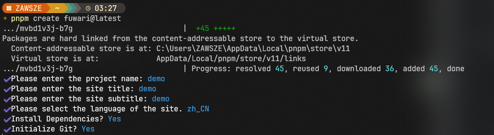

## 项目模板
# 基于 Astro 开发的静态博客模板。
::github{repo="saicaca/fuwari"}

## 环境依赖
- Node.js <= 22
- pnpm <= 9

## 一、初始化项目
```sh
pnpm create fuwari@latest
```
### 依次输入
1. 项目名（文件夹名）
2. 网站标题
3. 副标题
4. 网站语言
5. 是否安装依赖（推荐安装）
6. 是否初始化Git（推荐安装）



## 二、本地运行启动

### 指令合集

下列指令均需要在项目根目录执行：

| Command                           | Action                            |
|:----------------------------------|:----------------------------------|
| `pnpm install` 并 `pnpm add sharp` | 安装依赖                              |
| `pnpm dev`                        | 在 `localhost:4321` 启动本地开发服务器      |
| `pnpm build`                      | 构建网站至 `./dist/`                   |
| `pnpm preview`                    | 本地预览已构建的网站                        |
| `pnpm new-post <filename>`        | 创建新文章                             |
| `pnpm astro ...`                  | 执行 `astro add`, `astro check` 等指令 |
| `pnpm astro --help`               | 显示 Astro CLI 帮助                   |

```sh title="运行项目"
pnpm dev
```